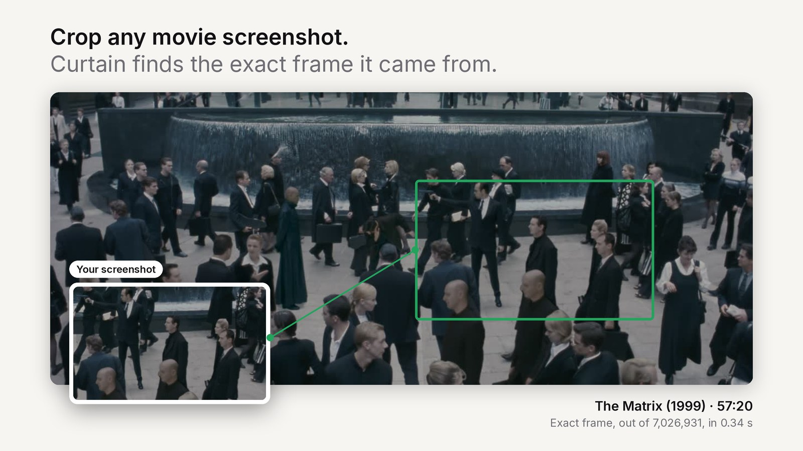
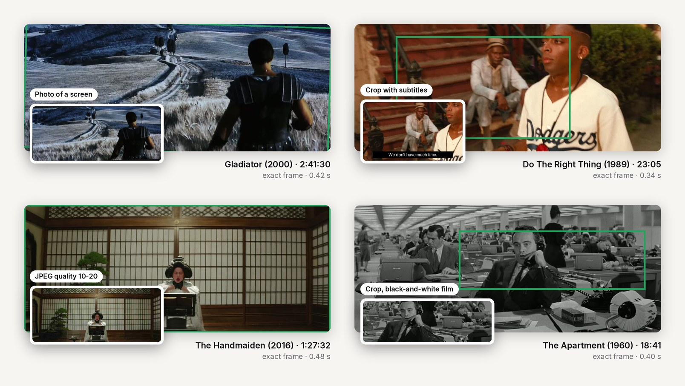
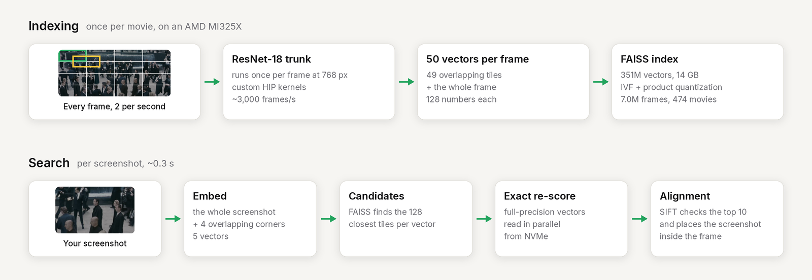

# Curtain

**Crop a screenshot from a movie, and Curtain finds the exact frame it came from.**

**[Try it at curtain.koushikkoushik.com →](https://curtain.koushikkoushik.com)**



474 movies · 7.0M frames · 351M embeddings · about 0.3 s per search

## Examples



Real searches against the live index. Each card is the query, and the green
box is where alignment placed it in the frame Curtain found. The examples are
hand-picked; the [benchmark](#how-well-it-works) below gives the actual rates.

## How it works



**The model.** A ResNet-18 trained from scratch with contrastive learning: two
altered views of the same frame (crop, lighting, resolution, blur, JPEG
quality) form a positive pair, and every other frame in the batch is a
negative. Each image becomes 128 numbers, normalized so that similarity is a
dot product. The current model, `combined-rocm-50k-v1`, trained on full frames
and tiles together on an AMD MI325X ([docs/rocm-training.md](docs/rocm-training.md)).

**Tiles.** A tight crop doesn't look like its whole frame, so every frame is
indexed as 49 overlapping tiles (a 4×4 grid stepped by half a tile) plus the
whole frame. [rcmindex](rcmindex/README.md) computes all 49 from one pass of
the network per frame with custom HIP kernels, at about 3,000 frames/s: the
7.0M frames took 40 minutes of GPU time.

**Search.** The screenshot and four overlapping corner pieces are embedded and
looked up in a FAISS index over all 351M vectors (IVF with an HNSW coarse
quantizer, product-quantized to 32 bytes each). The candidate frames are
re-scored exactly from the full-precision vectors, read from NVMe in
parallel, and SIFT alignment checks the best 10 and finds where the screenshot
sits in the frame.

## How well it works

110 test queries from six validation movies that no model trained on, searched
against all 474 movies, with the site's full pipeline (tiles, pieces and
alignment):

| Query type | Exact frame | Same moment (±1 s) | Right movie |
|---|---|---|---|
| Full frame | 10/10 | 10/10 | 10/10 |
| Wide crop (70–90%) | 9/10 | 10/10 | 10/10 |
| Medium crop (40–65%) | 9/10 | 9/10 | 10/10 |
| Tight crop (20–35%) | 4/10 | 9/10 | 10/10 |
| Narrow sliver | 1/10 | 1/10 | 3/10 |
| Low resolution (160–240 px) | 9/10 | 10/10 | 10/10 |
| JPEG quality 10–20 | 7/10 | 8/10 | 8/10 |
| Colour shift and tint | 1/10 | 2/10 | 3/10 |
| Letterboxed | 7/10 | 7/10 | 7/10 |
| Crop with subtitles | 8/10 | 9/10 | 10/10 |
| Photo of a screen | 8/10 | 9/10 | 10/10 |
| **All** | **73/110** | **84/110** | **91/110** |

The suite is deliberately hard, and "exact frame" is strict: frames are half a
second apart, so landing on a neighbouring frame counts as a miss.

**Known weak spots.** Strong colour shifts and tints, narrow vertical slivers,
and greyscale screenshots of colour films (1/110 exact). The training
augmentation only varied saturation by ±15%, so the model treats "grey" as a
strong signal and sends greyscale queries to black-and-white films. Training
with greyscale and stronger colour changes is the next step.

## Repository

```text
curtain_ml/          Encoder, training and retrieval logic
rcmindex/            C++/HIP tile indexer for AMD GPUs, FAISS search, alignment
apps/                Search site
benchmarks/          Retrieval robustness checks against the live index
deploy/              systemd unit for the site
docs/                Training notes and README images
```

### Train and index

Training and indexing need a ROCm or CUDA GPU. The current model comes from
the ROCm trainer ([docs/rocm-training.md](docs/rocm-training.md)), and
`rcmindex` computes the tile embeddings ([rcmindex/README.md](rcmindex/README.md)):

```sh
rcmindex/build/rcmindex --model DIR --movies-from - --output DIR   # tile embeddings, movie dirs on stdin
.venv/bin/python -m rcmindex.build_faiss                           # one FAISS index, one copy per film
```

All frames are kept on this machine only. Apart from the six validation
movies, indexed movies are stored as 640 px WebP copies, about 30% of the
size of the originals. On the benchmark, alignment against them matched the
originals (75 vs 76 exact).

The original whole-frame trainer is described in [docs/training.md](docs/training.md).

### Search site

The server loads its checkpoint, FAISS index, tile arrays and frames from
`.local/`:

```sh
uv run python -m apps.server --host 127.0.0.1 --port 8781
```

Cloudflare Tunnel exposes it at `https://curtain.koushikkoushik.com`; the
origin stays bound to `127.0.0.1:8781`.

### Local data

Large inputs live in the ignored `.local/` directory:

```text
.local/
  screenshots/             Source frames
  frames-small/            640 px WebP copies (the only copy of most movies' frames)
  selected_screenshots*/   Training selections
  trained_models/          Checkpoints and experiment reports
  trained_indexes/         Older whole-frame embeddings
  rcmindex-model/          Exported trunk and head for rcmindex
  rcmindex-runs/           rcmindex tile arrays and timing reports
  faiss/                   FAISS tile index and catalog
  benchmarks/              Validation suite and results
  archive/                 Retired Rust, video, scripts, tests and probes
```
